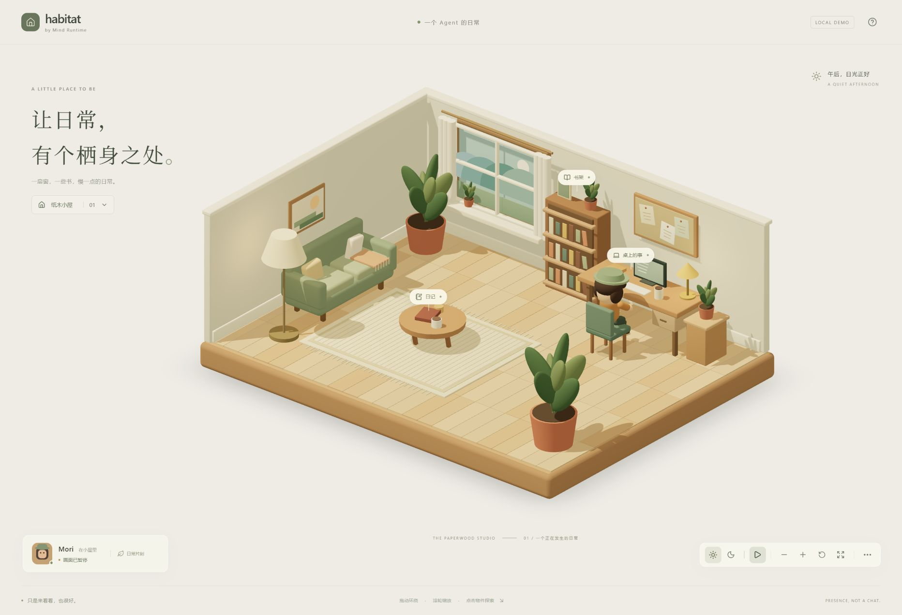

# MR Habitat

[English](README.md) | [简体中文](README.zh-CN.md)

A runnable 3D cabin prototype for observing an agent through movement, work, reading and rest. The public default branch uses authored/mock events and an original procedural puppet.



[Evening view](docs/screenshots/evening.png) · [Mobile view](docs/screenshots/mobile.png)

These screenshots document the public cabin prototype, not a live Mind Runtime connection or later unpublished assets.

## Run

Node.js 22.12+:

```bash
npm ci
npm run dev
npm test
npm run build
npm run preview
```

Open `http://127.0.0.1:5173` during development. Orbit, zoom, switch afternoon/night, inspect sample objects and trigger mock activity events. Pausing freezes local animation; external-event expiry still follows real time.

## Design and assets

[Design](docs/DESIGN.md) · [asset contract](docs/ASSETS.md) · [verification record](docs/VERIFICATION.md) · [product experiment](docs/product-experiment.md)

The public assets are original procedural work. Keep third-party assets and their dependent commits separate before publication. There is one room layout with two palettes. Real MR integration, general GLB import, automatic retargeting, long-run stability and real mobile performance remain unverified or unimplemented.

## Rights

No project-wide reuse license has been selected. All rights remain with their respective holders; public source visibility does not grant an open-source license. See [NOTICE.md](NOTICE.md).
