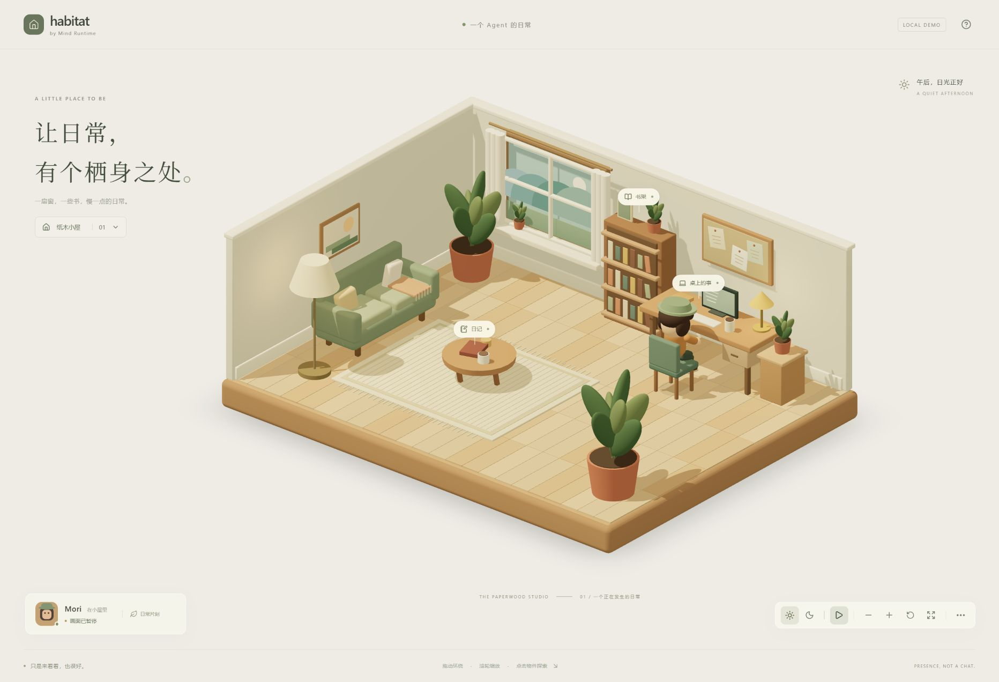

# MR Habitat

[English](README.md) | [简体中文](README.zh-CN.md)

可以运行的 3D 小屋原型，通过走动、工作、阅读和休息观察 Agent。公开默认分支使用编排／模拟事件及原创程序化木偶。



[夜晚画面](docs/screenshots/evening.png) · [移动端画面](docs/screenshots/mobile.png)

截图对应公开的小屋原型，不代表已接入真实 Mind Runtime，也不展示后来未发布的资产。

## 运行

需要 Node.js 22.12+：

```bash
npm ci
npm run dev
npm test
npm run build
npm run preview
```

开发模式打开 `http://127.0.0.1:5173`。可环绕、缩放、切换午后／夜晚、查看示例物品、触发模拟活动。暂停冻结本地动画，外部事件仍按真实时间过期。

## 设计与资产

[设计](docs/DESIGN.md) · [资产契约](docs/ASSETS.md) · [验证记录](docs/VERIFICATION.md) · [产品实验](docs/product-experiment.md)

公开资产为原创程序化作品。发布前需把第三方资产及依赖它们的提交分开。当前是一种房型、两套配色。真实 MR 接入、通用 GLB 导入、自动重定向、长期稳定性与真实移动端性能仍待实现或验证。

## 权利

尚未选择项目整体的复用许可证，权利由各自权利人保留；公开可见不等于授予开源许可。见 [NOTICE.md](NOTICE.md)。
