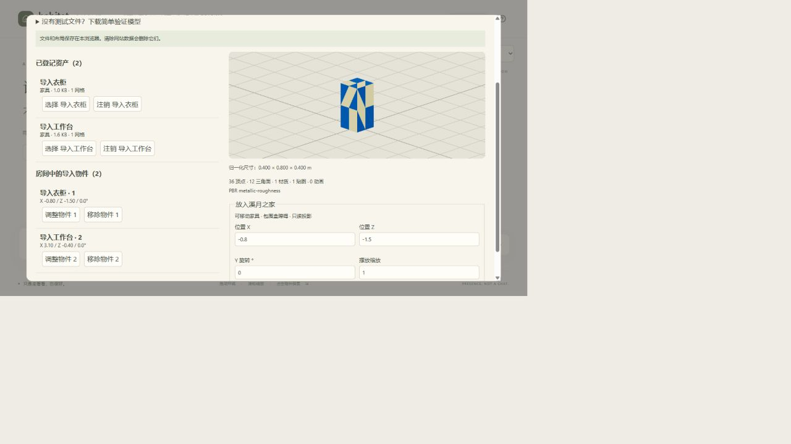

# GLB Asset Import & Registry V0 — 交付报告

日期：2026-09-08。基于本轮开始时已有、尚未提交的 Xiyue Home 实现继续工作；未覆盖既有改动，未提交或推送。本地生产预览：`http://127.0.0.1:4173/`。

## 用户操作

在溪月之家点击「资产库 / 导入 GLB」：选择或拖入文件 → 3D 预览 → 名称/类别/缩放/方向/落地/是否阻挡通行/点击行为 →「加入资产库」→ 设置 X、Z、Y 旋转和摆放缩放 →「放入房间并保存」。以后从资产库选择资产即可再次摆放，无须修改源码或手写 JSON。

房间物件列表可以调整、保存和移除。注销资产会同时移除房间中的引用；普通「移除物件」保留资产库文件。所有写操作等 IndexedDB transaction 完成后才报告保存成功。

## Asset Descriptor V0

`src/imported/descriptor.ts` 定义纯 JSON 数据：

- `schemaVersion: 1`：本 V0 的首版 schema。
- `id`：UUID；IndexedDB 唯一主键防止覆盖同 ID。
- `displayName` / `category`：用户可填写的名称、类别。
- `glbRef: indexeddb:<asset-id>`：逻辑文件引用；具体存储由 Web adapter 解析。
- `movable`：是否允许摆放后调整；与 interaction 完全独立。固定摆放的 prop 仍不是 Fixed Shell。
- `defaultScale`：导入归一化尺寸倍数。
- `localTransform.offset` / `yaw`：米制空间下的原点修正和弧度制 Y 旋转。自动居中，落地时移去 bounding box 的最低 Y；不修改 GLB binary。
- `collision.strategy: aabb | none`：通行 footprint 策略，none 即非阻挡装饰物。
- `interaction: {kind:none} | {kind:wardrobe} | {kind:projection,key:desk|books|journal}`。
- `info`：原始 bounding box、mesh/顶点/三角面/材质/贴图/动画数量、PBR/unlit 材质模型与字节数。

Descriptor 中没有 React component、Three.js Object3D、texture instance 或函数。Three.js 解析结果仅在内存中，renderer 外的语义使用数值、字符串和数组。未来其他 renderer 需要自行解析文件 locator、坐标系和视觉资源；本轮没有建立跨引擎标准。

## GLB 检查与预览

`glb.ts` 检查 GLB magic、版本、声明长度、chunk 边界/对齐、JSON、外部依赖、复杂度；GLTFLoader 实际解析后检查 mesh 存在、顶点有限值、索引范围、包围盒与大致尺寸，收集材质/贴图统计。文件不符合要求时在资产库显示错误，不注册坏资产，不替换原场景。预览和单个导入实例有局部错误边界。

预览支持环绕查看、缩放倍数、Y 方向调整和落地修正。原始偏移 pivot 的三个测试模型均通过 wrapper 修正。导入 GLB 中的灯不接管世界灯光；动画显示静态姿态。

当前支持自包含、Y-up、未依赖 Draco/Meshopt/KTX2 解码器的 GLB 2.0；允许内嵌贴图及 data URI，不加载外部文件。文件上限 32 MB；最多 200 万顶点、100 万三角面、2048 mesh / 4096 nodes。超限明确拒绝。这是 V0 的兼容范围，不宣称覆盖所有 GLB 扩展或异常 GPU/驱动情况。

## Binary / Registry / Layout 持久化

使用原生 IndexedDB，无新增服务器或运行时数据库依赖：

- Database：`habitat-imported-assets-v0`，数据库版本 1。
- `assets` store：主键 `descriptor.id`，每条记录为 `{descriptor, blob}`。raw GLB 作为 Blob 存储，不进 localStorage。
- `layouts` store：实例 key `xiyue-home-v1:local`，记录通用 `items` 列表。
- Placement：`{id, assetId, x, z, yaw, scale}`。多个 placement 可以引用同一个 asset。
- 注册使用 add 而非 put，ID 冲突报错；注销在一个事务内删除 binary/descriptor 和所有 layout 引用；保存拒绝悬空 assetId。
- 当前库上限 32 个资产 / 256 MB，当前房间最多 32 个 imported placement。

刷新时读取 binary 并重新解析，恢复 descriptor 与 placements。存储不可用时明确报错；解析失败的既存条目显示错误并可注销。有缺失资产或非法附加布局时不渲染该附加布局，也不让角色沿错误障碍移动；原世界仍可用。

所有内容是浏览器 origin 本地数据，端口不同即不同存储。清除网站数据、浏览器数据被驱逐或更换浏览器会失去库；没有云同步、备份导出或持久存储配额保证。

## Collision / Navigation

`placement.ts` 把 GLB 原始 bounding box 的 XZ 角点应用 local origin、导入 scale/yaw 和 placement scale/yaw，生成保守 AABB。导入 props 与原房屋/家具障碍合并，复用现有带 0.2m clearance 的 navigation。

放置前检查地板范围、墙体/家具重叠、原有全部交互锚点可达性。wardrobe/projection 还从包围盒四周计算可达接近点。旋转后的包围盒可能保守拒绝一些视觉上放得下的模型；不是 mesh-level physics。

每次保存更新导航，并把角色回到玄关，取消旧路径，避免新家具覆盖行走中的角色。这沿用现有家具 demo 的简单恢复策略，没有新增通用动态 navmesh 或 physics。原 sofa/coffee layout 的改动也检查 imported obstacles；没有把用户家具写回 base Xiyue definition。

## Interaction Binding

ImportedLayer 根据 descriptor 分派，所有新模型共用一条路径：

- none：普通视觉 prop，没有信息卡。
- wardrobe：点击 GLB mesh 或其标记 → 根据 placement 设置 Focus target 与可达 approach → 打开现有 Wardrobe → 现有 outfit 选择/自主规则/换装逻辑。没有单独给测试衣柜编写交互代码。
- projection：点击 GLB mesh 或标记 → descriptor 的 projection key → 现有 ObjectCard → `ProjectionProvider.read(worldId,key)`。数据继续 mock/read-only；GLB 和 descriptor 中没有具体 mock 内容。

## 三个验证模型与实测

`scripts/make-glb-fixtures.py` 生成极简非美术 box GLB。资产库内提供下载入口。没有使用 Blender 或 AI 3D 生成。

A. `crate.glb`：通过生产 UI 配置名称、0.9 导入缩放、90° 模型方向；登记、放入，再调整为 X=-0.7 / Z=-1.6 / Y=45°，保存并刷新恢复。开发 UI 中尝试重叠原沙发被明确拒绝。随后在生产 UI 注销该测试资产，资产与 placement 一并清理，base World 保留。

B. `wardrobe.glb`：通过 UI 设置 wardrobe；放在 X=-0.8 / Z=-1.5；实际点击绿色 GLB mesh，现有衣柜 Focus 面板打开，陶土 outfit 确实更新角色外观。

C. `projection.glb`：内嵌 2×2 PNG 贴图，预览识别 1 个材质与 1 张贴图；UI 选择 work/project projection，放在书房 X=3.1 / Z=-0.4。房间中实见棋盘贴图；点击 GLB mesh 展示现有工作/项目的只读 mock 信息。

额外异常测试：生产 UI 选择 `empty.glb` 显示“没有可显示的 mesh 网格”，资产库和房间仍正常使用。

刷新后 B/C 两个资产与摆放恢复。另通过「移除物件」移出工作台，确认资产库仍有两个资产、房间剩一个实例，再从库中重新放入并保存。切换到 Paperwood 后无导入模型，原工作桌投影正常；切回溪月之家恢复两个导入模型，原衣柜的 Focus / 自主选衣 / 返回流程继续正常。

## Tests / Build

- `npm test`：10 test files，48 tests 通过。
- 新增解析真实 GLB/原点修正/旋转包围盒、损坏文件与外部依赖拒绝、IndexedDB 往返与唯一性/注销事务/缺失引用、通用障碍合成/非法摆放/非阻挡装饰物/通用衣柜接近点测试。
- 原 Paperwood、Xiyue navigation / motion / semantic / rig tests 保持通过。
- `npm run build` 通过；保留已有 Three.js chunk 体积提示。
- 生产桌面浏览器完成 A/B/C 用户流程；控制台未发现 error，仅已有 THREE.Clock deprecated warning。

## 主动未实现

Draco/Meshopt/KTX2 decoder、其他格式或外部 texture glTF、自动格式转换、全屋/Fixed Shell 导入、复杂 gizmo、任意座椅 docking editor、动画播放扩建、mesh physics、商城/搜索/云同步/多人、正式跨引擎标准、MR/Hermes 接入均未实现。已有程序化家具未全部迁移至通用 registry。

## 判断

**对于上述 V0 支持范围内的 GLB，已达到“用户获得 GLB 后，无需 Coding Agent 即可导入 Habitat 使用”。** 导入、登记、绑定、摆放、移动、保存和刷新恢复均由 UI 完成。被明确拒绝的压缩依赖或超限模型仍需在外部重新导出为符合 V0 条件的 GLB；这不是任意 GLB 的全扩展兼容承诺。
