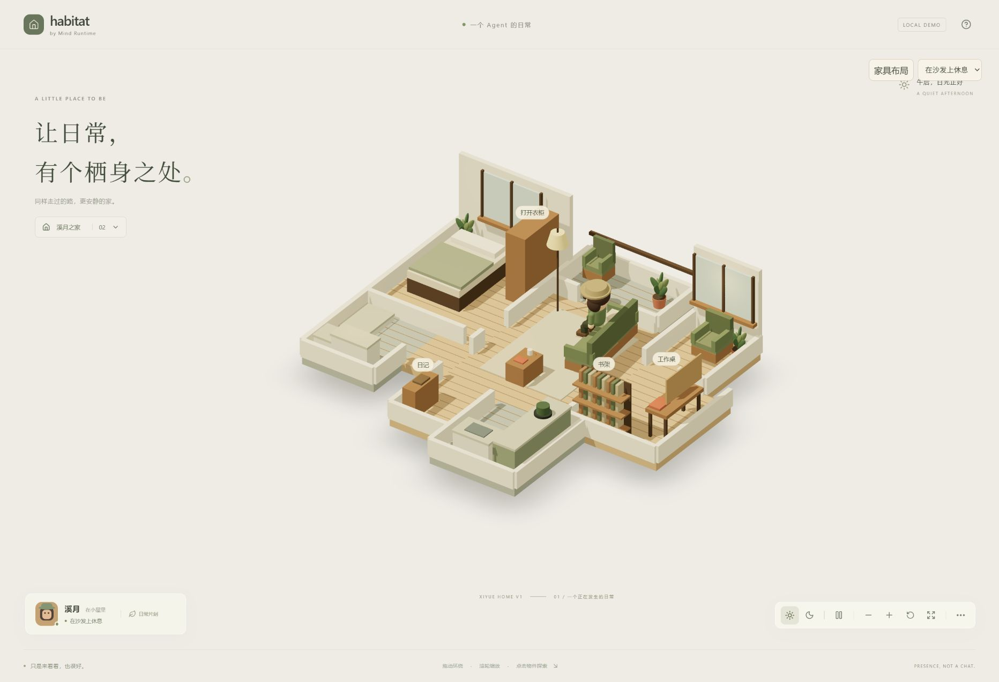

# Xiyue Home V1 — 实现与验收报告

日期：2026-09-08。基线：main / f8e3801d723d974c3e52812668a4bc6c6718fe17。
本轮为本地实现，未提交、未推送。启动：`npm run dev`；生产预览：`npm run preview -- --port 4173`。

## 1. World 组织

`src/assets/xiyue.ts` 导出 `createXiyuePackage(layout)`，返回独立 WorldPackage（definition + Surface），默认 ID 为 `xiyue-home-v1`。每个 package 复制自己的布局，同时用于 geometry 和 navigation。Paperwood 保留原 package 和原户型、角色配色、导航与镜头基准；左侧世界按钮的设置中可以切换。

房间关系按用户 Floor Plan：中央客厅，左侧卧室/卫浴，右侧窗边/书房，下方玄关/厨房，上方阳台。程序化 floor rectangle 总面积约 63.68㎡（含阳台及内部通道，非建筑测绘净面积）。作者坐标统一乘 0.95。门洞和紧凑家具间距为 0.2m 导航净空作适度调整。材质采用暖白、原木、苔绿、棉麻和陶土点缀；没有逐像素复刻图片。

## 2. Fixed Shell / Movable Props

`src/worlds/xiyue.ts` 中 rooms、walls、fixtures 描述固定地板、墙体分隔、门洞、窗和阳台，以及厨房/卫浴固定设备。`XiyueSurface` 用独立的 `FixedShell` / `MovableProps` group 渲染。墙体采用剖切展示；墙的视觉高度不会取消导航障碍。

床、衣柜、桌椅、书架、植物、沙发、茶几、地毯和灯均在 MovableProps 中。本轮只开放沙发与茶几的 override；其余可移动物件具有独立对象，但尚无布局控件。

## 3. 两件家具的实际移动

右上「家具布局」提供 X、Z、Y 轴角度，以及「演示：移动两个家具」。默认沙发 `(1.25,-1.25,-90°)`，茶几 `(0,0.9,0°)`；演示改为沙发 `(1.1,-1.1,约-84.27°)`，茶几 `(0.1,0.8,90°)`。坐标为作者单位，场景乘 0.95。两者分别改变 position 与 rotation，未改 Fixed Shell。

## 4. Layout 保存

`encodeLayout/decodeLayout` 保存 `{worldId, version:1, props}`。浏览器 localStorage key：`habitat:xiyue-home-v1:instance-local:layout-v1`。刷新恢复；错误 JSON、错误 world/version、非有限值回退；不通的已存布局经过 `safeLayout` 回退。保存失败会显示错误，不宣称保存成功。

这是每个浏览器 origin 的单一本地 instance override，不是多实例管理器或服务端同步。4173 与 5173 是不同 origin，保存互相独立。

## 5. 家具移动与 Navigation

复用 three-pathfinding。固定结构、室外遮罩、主要家具组成障碍；按新 Y rotation 生成保守 AABB，重建带 0.2m clearance 的导航。应用前拒绝离开客厅、两件家具相互重叠、任一交互锚点不可达的布局。

应用后明确把角色重置到玄关，取消旧位置/旧路线，避免新家具压到行走中的角色；这是开发验证控件的简化，不是无缝动态 navmesh。沙发 approach/dock/facing 随家具一起变换。测试覆盖移动后坐入沙发、离座到书房，以及路径中途改目标。

## 6. Wardrobe V0

点击衣柜 mesh 或「打开衣柜」标记进入专用 Wardrobe dialog 和 Focus 镜头，并将衣柜锚点设为行走目标。展示三套整装：苔绿日常、陶土围裙、靛蓝家居。选择即更新场景角色的上装、裤装、帽色；围裙/家居服还有简化几何差异。可由用户选择或让溪月自己挑。返回按钮/Escape 退出，恢复正常视角及自然日常。衣柜没有走普通 ObjectCard。

换装是即时替换，不等待角色到达；不会播放脱穿衣动画。衣柜未制作开门动画。当前 outfit 在浏览器本地保存；存储不可用时当次会话仍能换装。

## 7. Agent 自主选择

`runtime/wardrobe.ts`：夜晚优先靛蓝家居，白天优先苔绿日常；若与当前相同，选择列表中第一套不同的服装。界面标明「本地规则演示」。这是可体验的轻量决策，不代表审美 cognition，也不调用模型/MR。

## 8. Projection

`World object → onSelect(ObjectId) → ProjectionProvider.read(worldId,objectId) → ObjectCard`。

工作桌对应工作/项目示例，书架对应长期认知投影示例，日记对应最近经历。数据已从 world definition 移出到 `runtime/mockObservations.ts`，provider 在 `runtime/projections.ts`。返回独立快照，UI 只读；家具模型没有内嵌文字数据。后续可以替换 provider；本轮无真实 MR/OW 接入。

## 9. Anchors

已定义并验证可达：entry_return、sofa_rest、window_daydream、desk_work、bookshelf_read、kitchen_cook、bed_sleep、bathroom_bathe、wardrobe_focus，以及 balcony_air。右上目的地下拉可以实走所有锚点。

现有 activity 映射仍为 idle/working/reading/thinking/resting/sleeping。新增锚点不扩充语义协议；做饭、洗浴、阳台等采用到位后的 idle 表现。

## 10. Runtime 改动

- WorldSurfaceProps 增加可选 layout / onWardrobe；独立 Xiyue package 保证渲染布局与 definition 同源。
- HabitatScene 增加可选 targetAnchor、衣柜焦点，以及大户型 framing。
- Character 消费 world-level targetAnchor；CharacterAsset 增加可选裤装、帽色、服装风格。
- App 管理本地 world/layout/outfit/inspect state。
- 原 navigation、motion、semantic 和 characterRig 算法未重构。

## 11. 主动简化

普通 box primitives、低模家具、简单色块材料；大部分墙为剖切矮墙。没有正式 GLB、真实玻璃/布料、精细装修、IK 或新增动作系统。小摆件不是物理碰撞对象。移动验证限定两件客厅家具，旋转使用保守包围盒，可能拒绝视觉上看似能放下的位置。

## 12. 验证

- `npm test`：7 files / 40 tests 通过。
- 默认与移动布局，各 11 个点（spawn + 10 个锚点）的全部有向路线，共 242 次路径查询通过；navigation 本身检查整个路径段与障碍净空。
- 移动后的 docking/离座、行走中改目标、非法布局、存储解析、Paperwood 数据不变、outfit 选择和 provider 副本隔离通过。
- `npm run build`：通过。仍有 Three.js chunk 大于 500kB 的体积提示。
- Desktop 实际操作：衣柜 Focus、手选陶土围裙的角色变化、自主选衣、返回；两件家具移动/旋转/保存与刷新恢复；厨房移动；工作桌、书架、日记 mock/read-only 展开。

开发过程中曾出现 HMR 中间状态的路径失败；干净页面重新验证厨房路径正常，中途重定向补充测试通过。开发服务器热更新不作为最终运行验收环境。

## 13. 未实现

完整编辑器、任意家具移动/购买、墙体编辑、通用导入器、正式 world package 标准、多角色/多人、真实 MR/Hermes/Telegram、真实 cognition、完整服装建模、换装动画、上床躺卧、烹饪/洗浴专用动画、移动端深度性能优化、后端布局同步均未实现。

## 使用判断

本轮功能范围内，Xiyue Home V1 可以作为 Habitat 第二套独立 World Asset 使用。它是可加载、可交互、可保存布局的程序化本地演示资产；不是正式美术完成版或真实 MR 集成版。

### 最终生产构建复验补充

在 `http://127.0.0.1:4173/` 验证 Paperwood → Xiyue 往返切换，原房间、角色配色与交互恢复正常。衣柜前实见靛蓝上装/浅蓝裤装/蓝帽，角色到达衣柜锚点；自主选择后切回苔绿日常。生产版两件家具演示也成功应用并保存。

390×844 窄屏检查：页面 `scrollWidth=390`、`innerWidth=390`，无横向溢出，场景、控件与物件标记可见。测试后已恢复桌面视口。不是实体手机性能认证。

生产 origin 控制台未发现 error，仅保留上游 `THREE.Clock` deprecated 提示。开发 origin 有一次修改 effect 依赖数组时的 HMR 警告，生产加载未复现。

生产页面已实见移动后的沙发到达与 docking。最终场景截图：。

