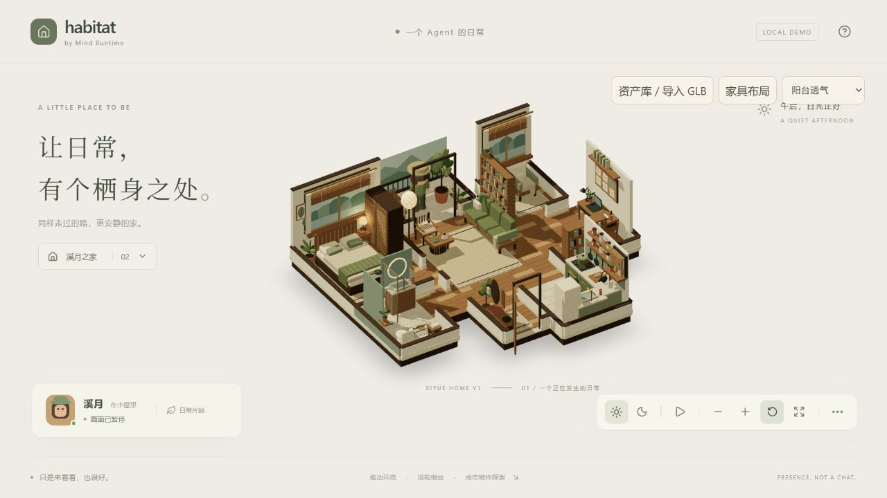
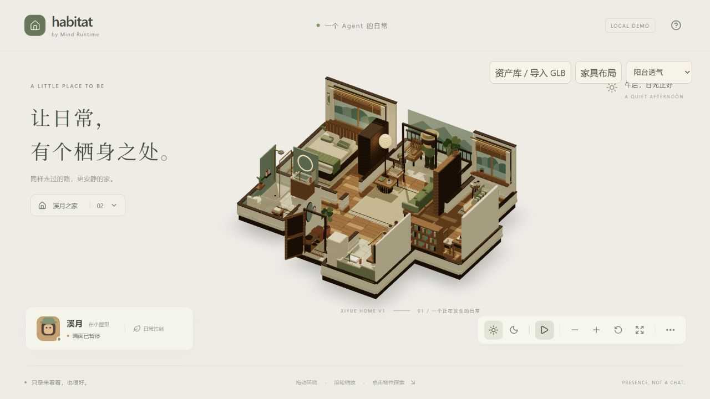

# Xiyue Home inventory audit

> 2026-09-09 修正：本文是物件清单记录，不能证明结构正确。玄关镜子朝向、门扇、卫浴镜柜墙面及卧室床向以 [结构校正记录](XIYUE_STRUCTURE_AUDIT.md) 为准；下文“最终内容”仅记录上一轮状态。

2026-09-08。按本轮「停止增加新物件；先补明确缺失，再删无依据重复；玄关按原设计；Projection binding 不得决定布局」执行。取代上一轮视觉报告作为当前 inventory 依据。

依据为用户原始附件，非上一轮助手清单：

- **图 A**：`codex-clipboard-102a7c3b-410b-48b5-9152-06628c211901.jpg`，Room Detail Moodboard，各房间格子。
- **图 B**：`codex-clipboard-208eae7f-646b-4618-b89f-a0c8ce134f8e.jpg`，Floor Plan、中央剖面与底部 Room Details。
- **文字要求**：各房间主要家具、功能区、重要陈设和生活物件应出现；可降低材质和模型规格，不能用几个代表元素替代房间内容。
- 两图的物件数量不完全一致，因此以主要家具／功能内容为必须项；小物件按本轮去重复要求限量。图中的装饰性标语不作为新增 UI 或功能指令。

## 逐房间核对及处置

| 房间 | 原始依据与应有内容 | 审计前问题 | 已执行处置与最终内容 |
| --- | --- | --- | --- |
| 玄关 | A 左上、B Returning／入口：木长凳、长镜、挂钩与织物／袋子、托盘与石头、鞋、落地盆栽、地垫、主入口 | 0.76m 高桌代替长凳；摆上了无图像依据的日记，并把整张桌绑定 journal；缺落地植物与可辨识主入口 | 替换成 0.45m 木长凳，开放凳下空间；鞋放地面；镜子、挂衣、托盘石头与搭布围绕长凳排列。迁入原冰箱顶那一处植物，改为落地株形；补图 B 的门框、门槛与向外打开的门。去掉日记和玄关 projection；保留地垫。近侧墙使用剖面可见性，不挪家具迁就标签。 |
| 客厅 | 文字明确沙发、书架、地毯、茶几、落地灯、书；B Living／Staying 另有木单椅；A 有靠枕、搭毯、杯子与书架植物 | 五项主家具已有；缺图 B 的木单椅；书架植物是通用宽叶盆栽 | 补且只补原图单椅，不附赠杯子、书、靠枕套餐。保留沙发／靠枕／搭毯、茶几、单只杯子及一本闭合书、地毯、灯、书架；书架植物改成原图的下垂株形。灯与单椅做小幅避让，默认和移动布局均验证连通。 |
| 窗边 | 文字明确大窗、帘／百叶、单椅、茶杯、书、花盆、窗外景；A 窗边桌有打开的书 | 桌和座椅各放一本闭合书；窗台与地面两处通用植物 | 保留大窗、百叶／帘、山水窗景、单椅／靠枕／搭毯、边桌。桌上改为唯一一本打开的书和一只杯子；删除座椅上的第二本书。保留一处窗台小盆栽；原地面盆栽迁到阳台，不另造一份。 |
| 书房 | 文字明确木桌、灯、书、纸、软木板；A／B Study 有工作椅、笔、电脑／笔记本与书架 | 桌灯复用卧室灯罩；额外套用杯子；桌面、墙架、落地书架三处通用盆栽 | 保留桌／抽屉、椅、电脑、既有闭合笔记本及纸、笔筒、软木板便笺、书架。替换成关节式工作灯。删杯子与两处架上盆栽，只留桌边一处。journal 绑定到既有笔记本查看点，不为绑定新增或移动桌子。 |
| 厨房 | A Kitchen、B Daily Warmth：台面／柜体、灶、锅、烤箱、洗槽龙头、冰箱、层架／罐子、挂具、窗口植物、毛巾；图中有水壶 | 缺水壶；冰箱顶无依据放植物；10 个罐子由同一尺寸等距循环生成 | 补一把水壶；其余主要功能物件保留。冰箱顶植物迁到玄关；厨房只保留窗口植物。罐子减到 6 个，分高矮和器皿色，不补其他装饰。保留砧板、面包、器具、擦手布与窗。 |
| 卧室 | A Bedroom、B Rest：床／枕／被褥、搭毯、床边桌与灯、衣柜、帘、植物、少量书／画 | 通用 window helper 在卧室窗台自动加盆栽，与已有床边地面植物重复 | 移除自动窗台盆栽，保留一处床边地面植物。床、分层床品、衣柜、床边灯／一本闭合书、窗帘、画和地毯保留。没有添加杯子、摊开的书或新的床头装饰。 |
| 卫浴 | A Bathroom、B Bathing：淋浴、玻璃屏、花洒、洗槽／木柜、圆镜、洗护用品、毛巾、植物、木凳、浴垫；B 平面有马桶 | 功能件齐全；凳上重复摆杯子 | 所有功能件保留；保留木凳和叠巾，删杯子。**A 的杯子确有图像依据，是本轮限制重复意象下主动删减的可选摆拍细节，不能说原图没有。** 原有一处植物保留。 |
| 阳台 | A Balcony 的山水远景、栏杆、木椅、小桌、杯／书与两侧植物；B Balcony 的座椅及植物围合 | 有栏杆、椅、桌，但背后仅空背景；单一宽叶盆栽无法形成原图的植物边界 | 补一层低成本山水远景，位于室外、不是可步行新区域。原大盆栽改成木本株形，接收窗边移来的第二处植物；不额外增加全屋植物总量。保留木椅、桌、一只杯和一本闭合书。 |

上述主要家具、关键功能内容当前均有对应几何。窗景、镜面、织物和小器皿保持 stylized 简化；本审计不声称逐像素或精确尺寸复刻两图。

## 重复意象账目

数量来自**真实场景构建函数执行**，不是从这份文档反推。

| 项目 | 修改前实测 | 修改后实测 | 最终分布 |
| --- | ---: | ---: | --- |
| 茶／咖啡杯 | 5 | **3** | 客厅 1、窗边 1、阳台 1。删除书房 1、卫浴 1。 |
| 植物摆放点 | 12 | **9** | 玄关 1、客厅 1、窗边 1、书房 1、厨房 1、卧室 1、卫浴 1、阳台 2。 |
| 散放闭合书 | 7 | **4** | 客厅 1、书房笔记本 1、卧室 1、阳台 1。 |
| 摊开的书 | 0 | **1** | 仅窗边桌上；替换原闭合书，没有同时叠加第二本。 |
| 散放书总计 | 7 | **5** | 不含有明确功能依据的书架藏书。 |
| 厨房层架罐子 | 10 | **6** | 两层各 3；主要功能层架保留，不按格子塞满。 |

植物逐项处置：

1. 卧室自动窗台盆栽：删除；床边地面植物保留。
2. 窗边窗台：保留，并改为小型株形；窗边地面：迁至阳台。
3. 厨房窗边：保留；冰箱顶部：迁到玄关落地位置。
4. 书房桌面：保留；墙架和落地书架顶部：删除。
5. 客厅书架：保留一处，改为下垂藤蔓。
6. 卫浴：保留原有一处。
7. 阳台：保留原大盆，改为木本枝叶；加上从窗边迁来的现有一处，形成两个不同高度。

书架藏书、沙发／窗边靠枕和设计图中各房间地毯有明确用途与依据，不因“重复”而机械删除。重构小物件不增加烹饪、进出门、阅读等玩法或动画。

## Projection binding 的边界

审计前查到的是**美术作者把玄关桌当 journal 宿主**：`entry-table` 分支放书，Surface 把整桌点击和固定玄关标记映射到 journal。没有发现 ProjectionProvider 在运行时写家具坐标的代码；不能把作者偏差误报成后端越权。

现已分开：

- `worlds/xiyue.ts`：设计与导航需要的家具坐标／尺寸。
- `worlds/xiyueSites.ts`：既有家具的美术查看点，跟随家具位置。它不导入 ProjectionProvider。
- `runtime/xiyueBindings.ts`：只保存 site ID → 内容键，没有坐标、尺寸或家具创建函数。journal → desk-notebook；desk → desk-surface；books → books-surface。
- `XiyueSurface`：先构建独立的场景，再为存在的查看点附加 UI。缺失宿主、空绑定或未知 site 不生成替代物件。玄关长凳无绑定。

回归测试验证：journal 宿主为现有书桌；没有 entry 宿主；清空或改绑不修改 props 与导航定义；未知 site 不创建宿主；移动美术宿主时查看点跟随它，方向不能反过来。

## 验证与复现

- `node scripts/audit-xiyue-art.mjs`：输出每个实际生成 assembly 的重复意象数量、Mesh 和三角面数。
- `npm test`：14 个文件、56 项测试通过；包括新 inventory 上限、缺失主要元素存在性、projection 单向绑定、所有房间在默认／移动布局下连通。
- `npm run build` 与修改文件的 Prettier、`git diff --check` 通过。
- 浏览器生产预览验证：书房「手记」打开日记投影，玄关不再有投影标记；角色到达阳台；默认和旋转视角检查玄关。截图见下。
- 未增加依赖或外部美术下载；保留之前存档、导入资产和其他未提交工作。本轮未提交或推送。

