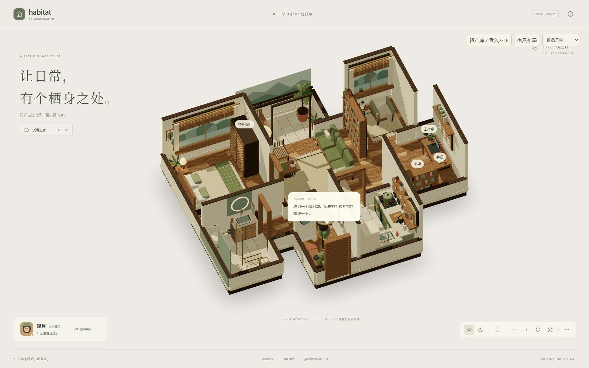
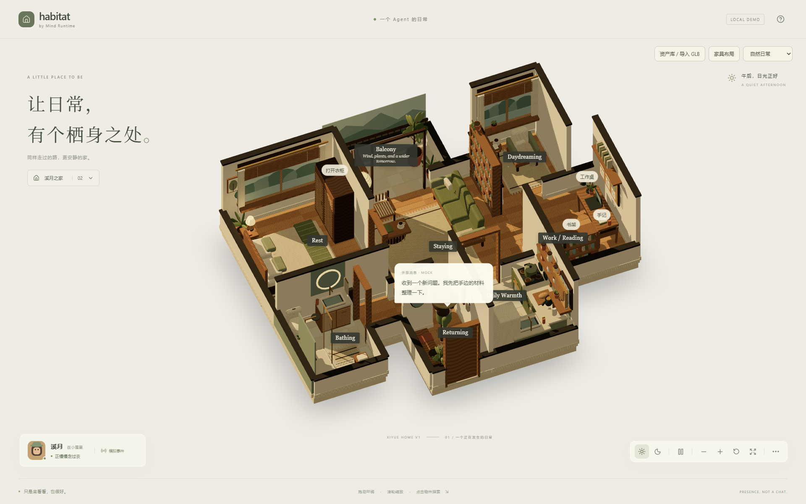

# Xiyue Home — moodboard fidelity pass

2026-10-11 · 分支 `feat/xiyue-home-v1`。以「Room Detail Moodboard」与「Floor Plan / 剖切图」两张设计图为参照，只调整呈现，不增删家具、不改导航与交互数据。

## 改动

| 项 | 之前 | 现在 | 依据 |
| --- | --- | --- | --- |
| 木地板 | 0.9m 短板、深浅交替（`oak`/`edge`），对比强 | 长条蜂蜜橡木板，错缝接头，两色微差（`floor`/`floorAlt`），粗糙度稍低 | 两图各房间地面 |
| 墙顶 | 棕色木纹 `dark`，0.035m | 炭黑 `cap`，0.06m，略宽于墙体 | 剖切图墙线 |
| 底座 | 棕色 `dark` 板 | 暖灰白 `plinth` | 剖切图外沿 |
| 光照（仅 Xiyue 白天） | 环境光 0.7 + 半球光 0.85，日光 2.5 | 环境 0.42、暖半球 0.75，低角度金色日光 3.6 | 两图的午后斜阳与投影 |
| 房间标牌 | 无 | 深色标牌：Returning / Staying / Daydreaming / Work / Reading / Daily Warmth / Rest / Bathing / Balcony（附副句）；随「显示标签」开关，不拦截点击；窄屏缩小并隐藏副句 | 剖切图标签 |
| 右上工具栏 | 按钮继承 16px 字号，`select` 不继承字体，压住天气说明 | 12px、统一字体；天气说明下移 | UI 缺陷 |

Paperwood 光照与材质保持原值。

## 顺手优化

- 昼夜切换不再重建整栋房屋几何（约 9.2 万三角面）：窗景与阳台远景共用 `sky` 材质，夜间只改材质颜色。`buildXiyueArt()` 不再接收 `night` 参数。
- 删除 `HabitatScene` 中只在创建时执行一次、且夜间色值与 `<color attach="background">` 不一致的背景设置。
- 删除 `:root` 中重复的 `font-synthesis`。

## 验证

- `npm test`：15 个文件、62 项通过；`tsc -b`、`vite build` 通过（500 kB 分包提示为既有）。
- 浏览器：白天 / 夜间切换、1440×900 与 390×844，无横向溢出，重新加载后控制台无新错误。
- 未做实体设备帧率测试。

