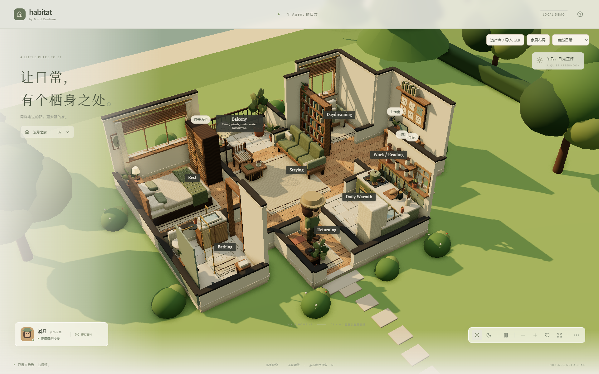
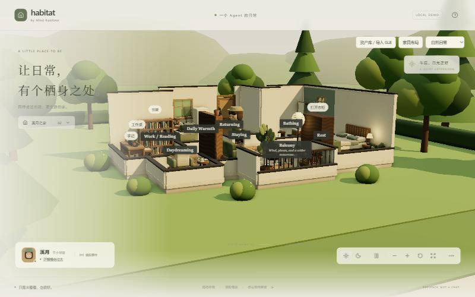
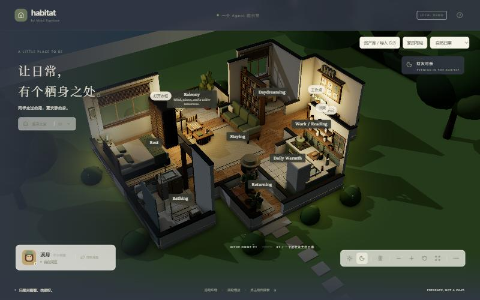

# Xiyue Home — Sims-style rendering pass (stage 1)

2026-10-11 · 分支 `feat/xiyue-home-v1`。回应三点：画风脱离等距平涂、固定剖面导致特定角度只看到墙、缺少外部环境。家具、导航、交互数据不变；纸木小屋不受影响。

## 改动

| 方面 | 之前 | 现在 |
| --- | --- | --- |
| 镜头 | 正交，方位角限制在约 160° | 透视（FOV 34），360° 环绕，可压低到接近地平线 |
| 墙体 | 写死哪些墙矮、哪些墙高 | Sims 式 Walls Cutaway：每段墙每帧判断，镜头一侧且背后是室内的墙降到 0.55 m，背面外墙保持全高；门框、窗、镜子、软木板等墙饰随墙隐藏 |
| 窗 | 窗洞里贴一块画了山水的板 | 墙体真实开洞 + 玻璃，透过窗看到外景；新增厨房水槽窗、卫浴高窗 |
| 外部 | 无 | 草坪地块、入户石板路、灌木与花、树篱、松树与阔叶树、北侧沙岸与湖面、对岸山丘与两层远山、天空渐变穹顶、距离雾 |
| 遮挡 | — | 树挡在镜头与房子之间时自动隐藏 |
| 光照 | 环境光 + 半球光 + 平行光 | 程序化 IBL（Lightformer，无 HDR 下载）+ 暖色低角度日光 + 软阴影 + GTAO 环境光遮蔽（three 自带 pass，无新依赖） |
| 夜间 | 偏亮、像阴天 | 冷色月光、压低环境光，室内四盏暖灯；页面换深色底 |
| 页面 | 画布嵌在页面中间，有硬边 | 画布全屏，标题区与底栏用渐隐遮罩保证可读 |

## 性能账（静态场景，`buildXiyueArt()` 实测）

| 部分 | 网格 | 三角面 |
| --- | ---: | ---: |
| 室内（地板、家具、陈设） | 146 | 76,080 |
| 墙体（全高版本） | 167 | 21,420 |
| 墙体（剖切版本） | 96 | 4,224 |
| 外部地形 | 14 | 15,156 |
| 树（23 棵） | 82 | 10,896 |

可见网格约 370 个；加上阴影与 GTAO 法线 pass，每帧约 1,000 次 draw call。地面不投影、距离超过 15 m 的树不投影。DPR 仍上限 1.5。**未做实机帧率测试**：桌面独显应无压力，集成显卡与手机需要实测；必要时可按设备关掉 GTAO 或合并墙体网格。

## 仍未达到 Sims 4 的部分

- 家具仍是代码拼的方块与圆角盒，不是建模资产；这是画面与 Sims 4 差距最大的来源。
- 角色仍是木偶占位。
- 材质大多是纯色 + 128 px 程序化纹理，没有壁纸、布料、木纹法线贴图。

