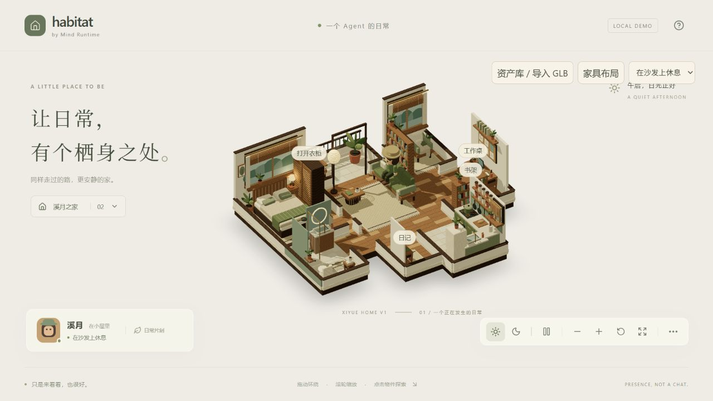
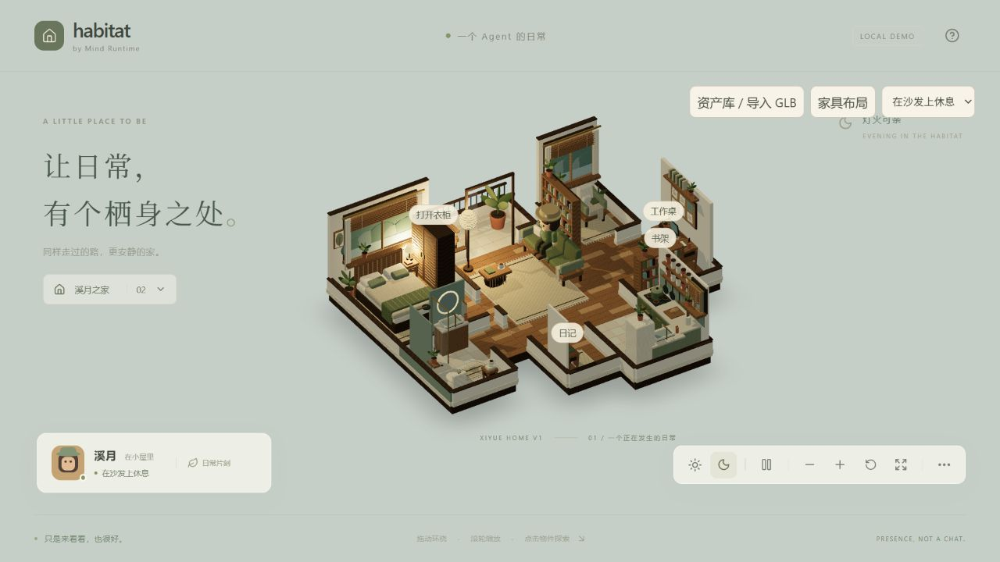
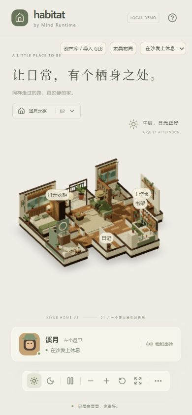

# Xiyue Home — stylized visual pass

> 历史快照：本报告之后已完成 [inventory audit](XIYUE_INVENTORY_AUDIT.md)。当前物件数量、玄关和 projection 绑定以该审计为准；保留下文作为上一轮实现记录。

2026-09-08 · 本地实现，未提交或推送。开始时为 main / 8464d7a，目录已有 Xiyue、GLB registry 等未提交工作；本轮保留这些工作。

本轮按用户给出的两张设计图补充内容，用 Web 可运行的低面数程序化模型实现安静、原木、暖白、苔绿的生活空间。画面是 stylized 实时场景；不将它表述为已经达到商业 Sims 4 的美术完成度。

## 八个空间

| 空间 | 当前可见内容 |
| --- | --- |
| 玄关 | 木桌及下层鞋架、鞋、椭圆镜、挂钩、围巾、布袋、托盘与石头、日记、搭布、地垫 |
| 客厅 | 三段式软垫沙发、靠枕、搭毯、成组书架与书、纸灯罩落地灯、木茶几、书、带杯柄的茶杯、编织地毯 |
| 窗边 | 大窗、半卷百叶、窗帘、分层山水窗景、扶手单椅、靠枕、搭毯、边桌、茶杯、书、盆栽与地毯 |
| 书房 | 木桌及抽屉、木椅、桌灯、笔记本电脑、书、带笔迹的纸、笔筒、茶杯、软木板与六张便笺、壁架和书、盆栽 |
| 厨房 | 柜门与把手、操作台、灶圈、带盖锅、烤箱、洗槽与龙头、冰箱及便签、储物壁架、罐子、挂锅和木勺、砧板、面包、器具筒、擦手布、百叶小窗与植物 |
| 卧室 | 木床头、床架、软床垫、分层枕头、被褥、搭毯、床边桌、台灯、书、百叶衣柜、窗帘、大窗、装饰画、植物、床下地毯 |
| 卫浴 | 瓷砖、淋浴底盘、玻璃屏与支架、花洒、置物架与洗护瓶、可辨识的马桶、水槽木柜、龙头、圆形灯边镜、皂液瓶、毛巾架、植物、木凳与叠巾、杯子、浴垫 |
| 阳台 | 开放栏杆、木条座椅、小圆桌、书与茶杯、较大的陶盆植物、与客厅相连的门框 |

## 实现取舍

- 静态几何按材质合并，独立保留沙发、茶几及可点击物件的父变换。没有新依赖、远程纹理、模型下载或新增玩法。
- 坐垫、枕头、床垫和器物使用低分段圆角与曲面；木作保留分层、门缝、腿、把手和书脊。
- 两张 128×128 本地生成纹理表达木纹和织物；共享材质，销毁场景时释放几何、材质与纹理。
- 保留现有 DPR 1–1.5、单方向光阴影、两处无阴影点光源、单次接触阴影策略。调整 Xiyue 的日光方向、环境强度及灯光位置；Paperwood 光照参数保持原值。
- 调整 Xiyue 默认观察方向与取景比例，避免高墙背面遮住厨房、书房。近侧仍为剖面低墙。
- 默认茶几移到沙发前；客厅书架位于沙发后。新增落地家具从同一 props 数据生成导航占地。卫浴洗手台移到房间北侧以便镜子可见。
- GLB 通用放置测试原来使用的坐标现在是默认茶几位置，所以把成功放置的测试样例移到新的空地；保留碰撞、全锚点可达和交互接近点断言。

## 验证

- `npm test`：12 个测试文件、52 项通过。包括默认与移动布局的全房间互通、沙发 docking、途中改道、GLB 放置及资源处理。
- `npm run build`：通过。构建仍有 Three/R3F/Drei 合并包超过 500 kB 的提示，未通过调高阈值隐藏它。
- `git diff --check`：通过；最终修改文件的 Prettier 检查通过。
- 静态场景实际生成统计：**163 个合批 Mesh、92,016 个三角面、约 8.42 MiB 几何属性数据**。统计不包含角色、外部导入模型、阴影重复绘制和浏览器开销；Mesh 数不等于整帧 draw calls。
- 生产浏览器：日夜切换、工作桌投影信息、衣柜入口、两件家具移动/旋转/保存与恢复、沙发到达、暂停、全屏检查通过。最后一次默认茶几调整后重新加载生产版并实见角色到达沙发。
- 390×844 窄屏：Canvas 可见，`scrollWidth = innerWidth = 390`，无横向溢出；已恢复桌面视口。
- 生产控制台未发现 error；有上游 `THREE.Clock` deprecated 警告。
- 未做实体手机 GPU 帧率、长时间运行或低端设备性能认证。不把几何统计等同于流畅帧率证明。

## 预览与存档

本次保留的生产预览：[http://127.0.0.1:4174/](http://127.0.0.1:4174/)。使用独立端口，避免清除原来 4173 地址中已有的导入资产记录。

旧地址保存的家具布局仍然保留，茶几不会被静默重置。需要本轮摆位时，可在已有「家具布局」中选择「恢复默认布局」。如旧导入物件占用了新家具位置，原有验证器会报告冲突；本轮不清理其存档。

